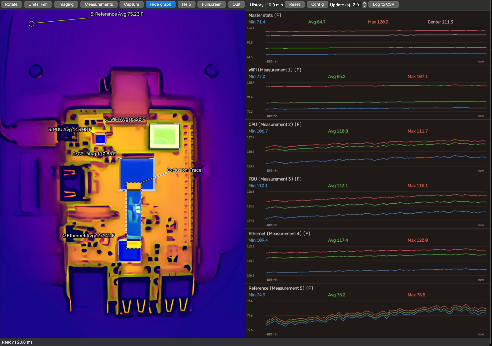

# based-thermals

A thermal-camera viewer for Apple Silicon macOS and Ubuntu Linux, with native
temperature measurements, recording, editable image-processing pipelines, and
folder-based Custom nodes.

The TOPDON TC002C Duo backend is physically verified. It captures native
256×192 radiometry at 25 fps and can use a 512×384 thermal upsample image.
Other camera integrations are extensible; physical dual-camera support remains
experimental. An included virtual camera lets you explore the UI without hardware.



*Application screenshot showing electronic component measurements, an exclusion area,
Min/Avg/Max history graphs, Fahrenheit readings, and viewport draw time.*

## Start here

1. Follow [installation and first launch](docs/setup.md) for your platform.
2. Open **Imaging** to select a preset or build a pipeline.
3. Open **Measurements** to draw temperature sampling areas.
4. Open **Capture** to save an image/data set, video, or timelapse.

| I want to…                                                     | Guide                                                 |
| -------------------------------------------------------------- | ----------------------------------------------------- |
| Install, update, authorize USB, or fix startup                 | [Setup](docs/setup.md)                                |
| Save images, record video/timelapse, or export temperatures    | [Capture how-to](docs/capture-guide.md)               |
| Change camera settings, build pipelines, or combine images     | [Imaging and pipelines how-to](docs/imaging-guide.md) |
| Draw spots/areas, exclude regions, configure labels and graphs | [Measurements how-to](docs/measurements-guide.md)     |
| Use the supplied Codex skills                                  | [Skills guide](docs/skills.md)                        |
| Create a Python/JSON processing package                        | [Custom nodes](docs/custom-nodes.md)                  |
| Understand temperature corrections and calibration             | [Calibration](docs/calibration.md)                    |

## Quick launch

Requirements: Python 3.12+, [uv](https://docs.astral.sh/uv/getting-started/installation/),
and a supported host. Ubuntu also needs the libraries and camera udev rule in
the [setup guide](docs/setup.md#ubuntu-2404-and-later). Install those first.

```sh
git clone https://github.com/manbehindthemadness/based-thermals.git
cd based-thermals
uv sync --no-dev
.venv/bin/based-thermals-desktop --rotate 90
```

Run the viewer as your normal user. On macOS, only the separate Duo USB helper
requests sudo authorization in the launching terminal. On Ubuntu, the udev rule
provides camera access without running the viewer as root.

To explore without a physical camera:

```sh
.venv/bin/based-thermals-desktop --camera virtual-dual
```

The virtual camera generates synthetic images and temperatures; it is not a
calibration reference or evidence of physical dual-camera compatibility.

Startup checks CPU, Apple CoreML, or Linux NVIDIA CUDA support before opening a
camera. Needed runtime replacements are verified and cached separately, so
`uv sync` does not overwrite them. Initial GPU setup can download large libraries.
Optional setup failures retain CPU fallback. See [runtime setup](docs/onnx-runtime-setup.md)
for retry, offline operation, exact compatibility limits, and tested Orin/Spark cases.

## What you can do

- Inspect temperatures under the pointer; draw spots, rectangles, ovals, polygons,
  and Bézier areas with minimum, maximum, and average readings.
- Exclude regions from user measurements; graph and log readings to CSV.
- Save PNG images with matching lossless radiometric NPZ and JSON metadata.
- Record MP4 video or timelapse, optionally including the cursor and graphs.
- Adjust supported camera hardware controls and apply software filters,
  palettes, transforms, AI enhancement, styling, and Custom processing packages.
- Add pipeline branches, blend or replace regions, and save/import/export presets.
- Rotate the view, choose landscape/portrait graph layout, and use fullscreen.

Image processing changes display pixels. It does not improve the camera's native
temperature accuracy or add measurement pixels. Measurements sample the native
thermal data behind the display, including when pipelines distort or reposition
images. Saved temperatures remain Celsius when the UI displays Fahrenheit.

## Main controls

| Control      | Shortcut                               | Purpose                                           |
| ------------ | -------------------------------------- | ------------------------------------------------- |
| Capture      | `C`; `S` to save image data            | Image/data, video, timelapse                      |
| Imaging      | `V`                                    | Camera settings and processing pipelines          |
| Measurements | `P` toggles quick spot placement       | Draw and manage temperature areas                 |
| Rotate       | `O` rotates 90°                        | Orientation and portrait/landscape layout         |
| Units        | `F`                                    | °C/cm or °F/in                                    |
| Show graph   | `G`                                    | Show/hide chart pane                              |
| Log to CSV   | `L`                                    | Start/stop temperature logging; show graphs first |
| Help         | Space                                  | On-screen control help                            |
| Fullscreen   | Escape leaves fullscreen               | Restore the previous window size on exit          |
| Quit         | `Q`; Escape outside drawing/fullscreen | Close the viewer                                  |

While drawing, Enter/**Finish** completes a shape and Escape/**Cancel** discards
the draft before fullscreen/quit handling. In portrait layout, charts and their
controls move below the image. Smaller windows use Qt's toolbar overflow menu.
Watch the status bar for download progress, camera errors, and rejected settings.
The number beside the status is elapsed viewport draw time in milliseconds:
image preparation, measurement overlays, graph composition, frame copying and Qt
painting. Camera waits, file saving, input handling, asynchronous processing and
OS display latency are excluded; `-- ms` means no completed frame is available yet.

## Browser viewer

```sh
.venv/bin/based-thermals --rotate 90
```

Open `http://127.0.0.1:5001`. The browser viewer provides an MJPEG feed and status;
the desktop guides describe the richer Qt controls. The web `--ambient` option
retains software ambient anchoring; desktop ambient correction is a camera setting.
Only use `--host 0.0.0.0` when you intend to expose the viewer on your network.

## Reference and development

- [Pipeline nodes and processing rules](docs/processing-pipelines.md)
- [Bundled presets](docs/pipeline-presets.md) and [visual AI models](docs/visual-models.md)
- [Measurement geometry and storage](docs/measurements.md) and [camera palettes](docs/palettes.md)
- [GPU runtime setup](docs/onnx-runtime-setup.md), [Linux CUDA](docs/nvidia-linux.md),
  [Jetson/Orin](docs/nvidia-jetpack.md), and [DGX Spark](docs/nvidia-spark.md)
- [macOS USB helper](docs/macos-usb.md) and [camera backend architecture](docs/camera-backends.md)
- [Development and diagnostics](docs/development.md) and [external experiments](experiments/README.md)

From the repository root, development checks are:

```sh
uv sync --dev
uv run pytest
uv run ruff check .
```

Application source lives in `src/based_thermals`; Python imports use `based_thermals`.
Commands and preference/cache locations use `based-thermals`. Existing checkouts
and IDE configurations stay in place. See [setup](docs/setup.md#update-an-existing-checkout)
for the one-time transition of older saved data.
Optional example packages live in `examples/custom_nodes/`; the based-gan example
is a separate Git submodule. See [Custom nodes](docs/custom-nodes.md) and the
[skills guide](docs/skills.md) for building and extending the project.

## License and acknowledgements

See [LICENSE](LICENSE). Model weights and examples retain their own provenance
and license notices; the application license does not replace them.
The project began as a macOS adaptation of [tna76874/topdon](https://github.com/tna76874/topdon),
which credits PyThermalCamera and P2Pro-Viewer. Direct UVC handling builds on
Samuel Loury's published TC001N/`2bdf:0102` analysis. The original BSD 2-Clause
license is retained.
