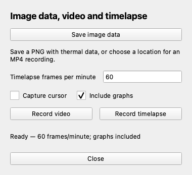

# Capture: images, video, timelapse and temperature logs

[Documentation home](../README.md) · [Setup](setup.md) · [Measurements](measurements-guide.md)

Open **Capture** from the toolbar or press `C`. Choose the appearance in
[Imaging](imaging-guide.md) and arrange measurements before capturing.
Saving and recording use the current display; radiometric arrays remain native.



*Capture configured for 60 frames/minute with graphs included. Use the two Record
buttons to choose video or timelapse; Save image data produces the three-file set.*

## Save an image and its thermal data

1. Open Capture and choose **Save image data**, or press `S` in the viewer.
2. Choose a filename in the native macOS or Ubuntu Zenity Save dialog.
3. Wait for the status bar to confirm the save.

A single chosen name creates a matching set:

| File    | Contents                                                                                            |
| ------- | --------------------------------------------------------------------------------------------------- |
| `.png`  | Viewable processed thermal image and configured capture overlays                                    |
| `.npz`  | Lossless native `uint16` counts and `float32` Celsius temperatures, with capture data               |
| `.json` | Time, statistics, orientation, camera/environment metadata, selected-pixel information and validity |

Keep the files together when sharing or analysing a capture. The PNG is for
viewing; use the NPZ for numerical temperature work. Enlarging or styling the PNG
does not enlarge the native measurement grid. Fahrenheit display does not convert
the stored Celsius temperature array.

### Inspect an example capture

Download the matching [PNG](examples/synthetic-capture.png),
[NPZ](examples/synthetic-capture.npz), and [JSON](examples/synthetic-capture.json).
These were written by the application's capture function from its virtual camera,
not by a physical sensor. The sample has an 80×60 native grid; the Duo's is 256×192.
The displayed overlays do not remove pixels from the stored native array.

From the repository root, inspect the numerical data with NumPy:

```python
import numpy as np

with np.load("docs/examples/synthetic-capture.npz", allow_pickle=False) as data:
    celsius = data["temperatures_celsius"]
    print(celsius.shape, celsius.dtype)  # (60, 80), float32
    print(float(celsius[30, 40]))  # indexing is [y, x]
    print(bool(data["measurements_valid"]))
```

Use `temperatures_celsius` for temperature analysis. The virtual camera's raw
encoding differs from the Duo's; the JSON identifies the profile and validity.

Camera reads continue while the Save dialog is open. Check validity metadata when
capturing during shutter calibration or a stale frame: held readings do not
represent a new valid temperature sample. Before a valid frame, readings are unavailable.

## Record video

1. Open Capture. Set **Capture cursor** and **Include graphs** as desired.
2. If including graphs, choose **Show graph** before starting.
3. Click **Record video**, select an `.mp4` filename, and confirm the dialog.
4. Reopen Capture if necessary and click **Stop video** to finalize the file.

While choosing a filename the button reads **Cancel**. Closing Capture does not
stop a recording; the main toolbar and status show its activity. Quitting the
viewer finalizes an active recording. The other recording mode is unavailable
until you finish or cancel the current one.

The video contains rendered images and measurement overlays, not an NPZ-like
temperature plane for every frame. Use CSV logging when you need numerical
temperature histories. For the Duo, MP4 playback runs at 25 fps.

## Record timelapse

1. Set **Timelapse frames per minute** before starting.
2. Click **Record timelapse** and choose an `.mp4` filename.
3. Click **Stop timelapse** when finished.

The remembered rate defaults to 60 frames/minute: one captured frame per second.
On the Duo, the allowed range is 1–1500 frames/minute; it follows the camera's
maximum frame rate. Both video and timelapse play back at 25 fps on the Duo.

| Capture rate      | Sample interval | Duo playback speed |
| ----------------- | --------------- | ------------------ |
| 30 frames/minute  | 2 seconds       | 50× real time      |
| 60 frames/minute  | 1 second        | 25× real time      |
| 120 frames/minute | 0.5 seconds     | 12.5× real time    |

You can set the initial rate with `--timelapse-fpm 120`. The rate is locked while
recording or choosing a recording filename; stop first to change it.

## Include the pointer or graphs

**Capture cursor** includes the moving sampler crosshair/readout while the pointer
is over the image. It defaults to off and can be changed during recording. Fixed
measurement overlays remain part of the image independently of that checkbox.

**Include graphs** includes the visible chart pane in PNG/video/timelapse output.
It defaults to off. Show graphs first; the recording's graph layout stays fixed
until it ends. Hiding graphs during recording leaves the reserved pane blank and
pauses graph updates. The checkbox is locked during recording and its Save dialog.
Graphs use their configured update cadence, rather than one new sample per video frame.

Application toolbars/help are excluded from the recording. Changing rotation
during recording fits the image into the original video dimensions with black
borders as needed; choose orientation before recording for a consistent composition.

## Export a temperature history to CSV

CSV logging is a chart control rather than an MP4 recording option:

1. Create/enable the measurements you need.
2. Choose **Show graph** (`G`) and set the graph **Update (s)** interval.
3. Choose **Log to CSV** (`L`), select a `.csv` filename, and confirm.
4. Choose **Stop logging** (`L`) to finish the log.

The pending dialog can be cancelled. Logs include canonical Celsius and selected-unit
values. Area measurements contribute minimum/average/maximum series; exclusions
produce none. Invalid calibration/stale frames are skipped instead of treated as
new samples. Graph-history compression does not reduce CSV's valid samples.

Measurement edits and relevant settings lock during logging and its pending dialog
to keep a consistent record. Stop logging to edit them. See
[Measurements](measurements-guide.md#graphs-and-history) for history configuration.

## If something goes wrong

- If another Save dialog is open, finish or cancel it before starting a new save.
- If recording continues after closing Capture, reopen it and press the Stop button.
- If the saved picture has a graph pane you did not want, uncheck Include graphs
  before the next capture; this does not change native NPZ dimensions.
- If temperature controls are greyed out, check for active/pending CSV logging or
  calibration. If the camera lacks radiometry, temperature logging is unavailable.
- Read the status bar for file/codec errors. Keep the PNG/NPZ/JSON set rather than
  relying on a visual image alone for later measurement analysis.
