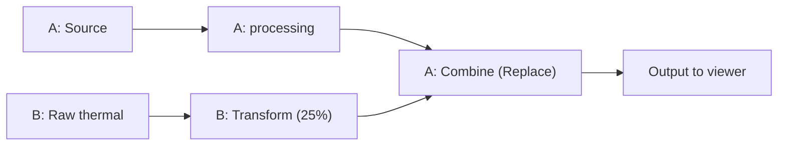

# Imaging and processing pipelines

[Documentation home](../README.md) · [Setup](setup.md) · [Capture](capture-guide.md) · [Measurements](measurements-guide.md)

Open **Imaging** or press `V`. This is where supported camera controls and
display-processing pipelines are configured. It replaces the older Camera label.
Hardware settings can affect camera-corrected measurements; software image
operations affect display pixels while measurements continue using native thermal data.

## Start with a preset

1. Open Imaging and select a bundled pipeline from the preset dropdown.
2. Expand nodes to inspect their settings; use bypass to compare an effect.
3. Watch the status bar for applied settings, downloads and processing errors.
4. Choose **Save current pipeline as…** to keep your own version.

Bundled presets start collapsed. Their names describe intended visual compositions,
not guarantees of speed or additional thermal accuracy. GPU preferences resolve
to an available backend or CPU; large AI models can be slower on some hosts.
See [preset reference](pipeline-presets.md) and [visual models](visual-models.md).

## Understand hardware and software

The **Camera hardware** stack contains supported controls such as the camera's
processing preset, detail enhancement, gamma, boost, noise reduction and palette.
Available features depend on the backend. A second hardware stack appears only
for an independently owned visible camera in a multi-camera configuration.
Physical dual-camera support remains experimental.

Hardware nodes are singletons. Bypassing/removing one restores the fields it owns;
commands follow an audited order, not the visual stack order. Original camera
overrides are restored on orderly exit. Ambient/reflected temperature, optical
transmission, relative humidity, distance and emissivity remain calibration controls
outside this stack. Use [calibration guidance](calibration.md) for those settings.

**Fixed detail** is a special mode inside Detail enhancement. It requires enabled
detail, Balanced processing, neutral camera gamma (50), and boost Off. Ordinary
processing presets do not all require this combination. Read the actual rejection
message before changing unrelated settings.

Software nodes run from top to bottom in each tab. A new blank pipeline starts
with **A**, whose fixed **Image source** feeds the stack and whose fixed **Output**
feeds the viewer. Source/output cannot be removed; Source cannot be bypassed.
Add processing nodes between them. The viewer's rotation is applied afterward.

## Build and edit a simple pipeline

1. Choose **Create new** to start unsaved work without deleting stored presets.
2. Expand **Image source** in A and select **Raw thermal** or **Thermal upsample**.
3. Right-click a node to add/insert a software operation, such as Contrast or Image filter.
4. Adjust it and compare with its bypass control.
5. Drag its grip to a valid placement bar to change execution order.
6. Save the pipeline under a name.

Add/insert menus are sorted alphabetically; execution order is the order you
choose in the stack. Expanding/collapsing a normal node changes its presentation.
A **Pipeline preview** node intentionally computes a thumbnail only when expanded.
Locked pipelines cannot be edited or reordered; stop logging/calibration first.

**Thermal upsample** is the camera's processed thermal preview, not a normal-light
camera. **Raw thermal** is a display of native thermal data. **Visible light** is
an experimental optical source and requires a backend providing it. Temperature
range nodes can force software thermal rendering even when Thermal upsample is
selected; camera-style colors in that path are approximate.

## Add branches and combine them

Use **+** to add a software tab (B, C, …). Each has its own Source. A is the
viewer output; another tab runs when connected by a **Combine** node or used by
an expanded Preview node. An idle tab does not automatically replace A.

Add Combine to the receiving stack and select another tab as its input. Choose
the blend mode and amount; optionally choose a mask source. Masks determine where
the effect applies. Links cannot form cycles. Combine can also use thermal upsample,
raw thermal or available visible-light inputs directly.

Use **−** to remove an unconnected auxiliary tab. A cannot be removed. Incoming
or outgoing blend/mask links prevent deletion, including links in bypassed nodes;
remove the links first. Surviving tab names remain stable.

### Example: put a raw thermal inset in a processed image

1. Keep the main composition in A. Add B with **Raw thermal** as its Source.
2. In B, add **Transform** and select **Scale within canvas**.
3. Set Width/Height to a smaller percentage (for example, 25% each).
4. Set Position units to Percent and X = 0, Y = 0 for the upper-left corner.
5. In A, add **Combine**, select B, choose **Replace**, and use full blend amount.

Replace copies B's occupied region, including genuine black pixels, while leaving
the rest of A intact. Other blend modes can treat black differently. Position X/Y
uses the canvas's upper-left corner; changing units reinterprets the values.

Transform also offers mirroring, skew, corner distortion and **Change working
resolution**. It preserves source detail through later nodes and Combine within
the software output limit; it does not create additional thermal measurement data.
Measurements stay on the background thermal canvas rather than moving into the inset.
See [node/Combine reference](processing-pipelines.md) for limits and exact parameters.

## Add AI or a Custom node

For enhancement, add **AI enhancement**, select a model, and start with Native
sensor input and a single pass. Each ACNet pass doubles both dimensions; the
software output limit is 4 megapixels. Downloadable models install in the
background on first use. While pending, the effect is absent and the live feed continues.
DnCNN/FFDNet need the separate conversion described in [visual models](visual-models.md).

The **Execution** selector reflects the effective CPU/CoreML/CUDA backend.
Saved GPU intent survives fallback; explicit CPU stays CPU. Apple compute-device
choices apply to CoreML. Provider availability does not guarantee every model
operation runs on GPU or that a model is faster. If inference fails, inspect its
status reason and bypass the node to continue without that effect.

Add **AI image styling** separately for art/color effects. These images are
visual interpretations, not recovered visible-light colors or radiometric evidence.

For your own processing, add **Custom** and select a trusted folder package.
Code is embedded in saved/exported pipelines and runs with application permissions
in processing workers. Inspect packages before loading pipelines from others.
[Custom-node documentation](custom-nodes.md) explains imports, controls and model
helpers; [$create-custom-node](skills.md#create-a-custom-node) helps author a package.

## Save, import and export

The dropdown retains the loaded preset name while you edit and after reopen/restart.
**Update pipeline** saves open edits to that preset; updating a bundled preset creates
a user override. **Save pipeline** asks for a name when no preset is loaded.
Restored working edits and saved preset contents remain separate until you update.

- **Save current pipeline as…** saves a separate named version.
- **Rename current pipeline…** preserves saved contents and open edits; update to save edits.
- **Delete current pipeline…** removes the saved entry after confirmation but keeps open work.
- **Import pipelines** accepts individual JSON files or bundles; name conflicts offer
  Rename, Replace or Skip, and loading the first selection is optional.
- **Export pipelines** lets you choose open work, saved presets, or both.
- **Restore defaults** returns to the application's default settings/pipeline behavior;
  export important custom work before deliberately resetting configuration.

## Manage model downloads

Choose **Clear downloaded model cache…** from the preset dropdown and confirm.
The operation reports file count and freed space. It removes recognized downloads
and checksum files while preserving bundled models, local exports, registered local
files, unknown files and symlinks. It is unavailable during downloads, logging or calibration.
Active nodes can download missing models again; bypass/remove them first if you
want the reclaimed space to remain free. Saved presets and native runtime caches remain intact.

## If the result looks wrong

Bypass nodes from the end backward to isolate the effect. Check Source, temperature
range, transform geometry, Combine links/masks, and model status before changing
camera settings. App colors and camera colors are separate operations. A smaller
or distorted visible image does not change where thermal measurements are sampled.
Use **Rotate** in the main viewer for orientation and portrait/landscape chart layout.
