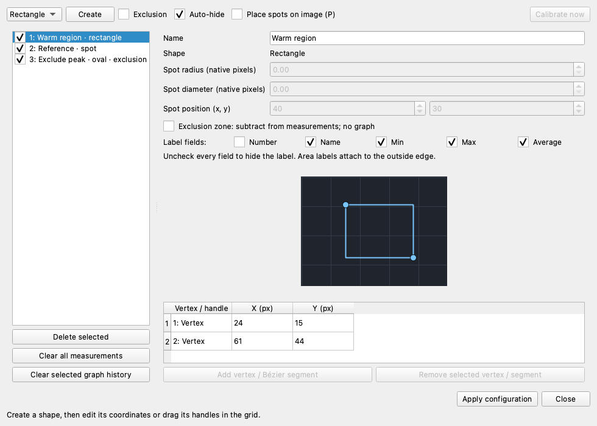
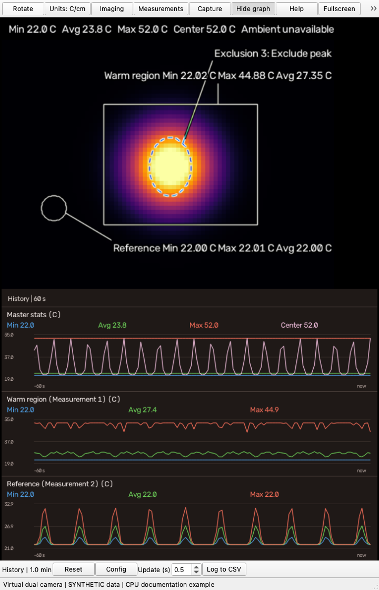

# Measurements: spots, areas, exclusions and graphs

[Documentation home](../README.md) · [Capture and CSV](capture-guide.md) · [Imaging](imaging-guide.md)

Open **Measurements** from the toolbar or right-click the thermal image.
All measurements use native thermal data, not palette colors, AI output or
transformed display branches. On the Duo this is a 256×192 sensor grid. A pixel
radius therefore refers to native sensor pixels, not the enlarged preview's pixels.

*The selected rectangle has Name/Min/Max/Average labels enabled. The list also
contains a positive-radius spot and an oval exclusion. This example uses the
virtual camera's 80×60 grid; use your camera's native coordinates for real measurements.*

## Create a measurement on the image

1. Choose Spot, Rectangle, Oval, Polygon or Bézier in the shape dropdown.
2. Leave **Exclusion** unchecked for a normal measurement.
3. Click **Create**. With **Auto-hide** checked, the dialog hides while you draw;
   uncheck it if you want to keep the dialog visible.
4. Draw on the live thermal image using the gestures below.
5. Press Enter or click **Finish** to create the measurement.
6. The dialog reopens. Set its name/label fields and click **Apply configuration**.

| Shape     | Drawing gesture                                                     |
| --------- | ------------------------------------------------------------------- |
| Spot      | Drag from center to radius; click for a single-pixel spot           |
| Rectangle | Drag between opposite corners                                       |
| Oval      | Drag the opposite corners of its bounding rectangle                 |
| Polygon   | Click at least three vertices                                       |
| Bézier    | Click-and-drag at least two anchors to set tangent direction/length |

Releasing a drag leaves a draft; it does not finish the measurement. Enter,
Finish or right-click completes it (Control-click also works on macOS).
Backspace/**Undo** removes the last anchor or cancels the current drag.
Escape/**Cancel** discards the draft; in fullscreen it cancels drawing first.
Graphs, toolbar areas and image padding are not drawing targets.

For quick single-pixel spots, press `P` or check **Place spots on image (P)**,
then click positions. Press `P` again to stop placement without removing spots.

## Configure, move or disable an area

Each measurement has **Line Color**, **Fill**, and **Opacity** controls.
Uncheck **Dynamic** to choose an RGB line color; Dynamic retains the contrasting
outline that follows the thermal image. **Fill** uses the same color inside
closed shapes and positive-radius spots. Single-pixel spots remain crosses.
**Opacity** (0–100%) affects the shape outline and fill. Labels and their
leader lines remain readable independently. Click **Apply configuration** to
save the appearance with the measurement; it is restored on restart.
These display controls do not change sampled temperatures, exclusions or graphs.

Select a measurement in the dialog's list. Use **Name**, **Label fields**, native
coordinates and the geometry editor to adjust it. Spots have linked **Spot radius**
and **Spot diameter** controls; radius zero samples a single native pixel. Editing
either size updates the other. Polygons and curves have a vertex/handle table and
controls to add/remove a vertex or Bézier segment.

**Apply configuration** commits changes. Selecting another measurement also applies
valid edits. **Close** dismisses the dialog without applying pending edits; it stays
available even when measurement editing is locked.

Drag a spot's crosshair or an area's body in the thermal image to move the whole
measurement. Its identity/name stays the same, and geometry stays inside the sensor.
Uncheck a list item to disable it without deleting its configuration. Use **Delete
selected** to remove it, or **Clear all measurements** to remove everything and reset numbering.

Rotation maps geometry with the thermal canvas. Pipeline Transform resizing,
skew, distortion, positioning and mirrors do not move sampling onto processed imagery.
For example, a measurement over a raw inset still samples the background native
thermal canvas at that location. Optical imagery needs explicit registration for
thermal overlays; virtual-camera registration is synthetic.

## Exclude pixels from sampling

Check **Exclusion** before creating a shape, or set an existing shape's
**Exclusion zone: subtract from measurements; no graph** option and apply it.
Enabled exclusions subtract their pixels from every enabled user measurement,
including a single-pixel spot. Disabling an exclusion stops that subtraction.

Exclusions have dashed outlines and no temperature graph or CSV series. They do
not change cursor readings, scene/master statistics, calibration, raw capture data,
or other pixels in the native thermal array. Ordinary overlapping measurement
areas sample independently; they do not subtract from one another.

In the illustrated scene, **Master stats** still has a maximum near 52 °C,
while **Warm region** peaks around 44.9 °C because the oval excludes its hottest
pixels. The bright center remains visible in the image and present in the
[sample NPZ](examples/synthetic-capture.npz): an exclusion changes user sampling,
not the image or saved thermal array. These are synthetic example temperatures.

## Readings and labels

Areas and positive-radius spots report minimum, average and maximum over remaining
finite native samples. Single-pixel spots have one temperature series. Fully excluded
or empty areas show unavailable values. If a frame is invalid during shutter
calibration or capture becomes stale, readings are held; graphs mark gaps and CSV
skips the invalid sample. Before the first valid frame, readings show `--`.

Use Label fields to include number, name, minimum, maximum and average. Uncheck
all fields to hide the label while keeping the outline. Area labels attach at the
outer edge, and the placer tries to avoid shapes and existing labels. A crowded
image can still have overlaps. Names also appear in graph titles and CSV labels.

Switching Units (`F`) changes temperature/distance display, not stored Celsius
values or calibration. Measurements cannot compensate for incorrect ambient,
distance, emissivity or reflected-temperature settings; see [calibration](calibration.md).

## Graphs and history

Choose **Show graph** (`G`). Landscape places charts to the right; portrait places
them below. Choose layout in **Rotate**; portrait chart controls move to the bottom.
Areas have Min/Avg/Max curves; exclusions never have charts.

*Portrait layout puts charts and their controls below the image. Warm region and
Reference each have three curves; Exclude peak has none. The same synthetic scene
appears in the README's landscape example. On narrow windows, use toolbar overflow
for controls that do not fit.*

- **Update (s)** sets the sampling/update interval.
- **Config** chooses the entire session or a recent time window, the point budget,
  and whether to compress older history. Compression preserves older peaks/gaps;
  without it, old points are discarded when the budget fills.
- **Reset** clears graph history. In Measurements, **Clear selected graph history**
  clears only that measurement's history while retaining its geometry.
- **Log to CSV** (`L`) records valid numerical samples. See [CSV how-to](capture-guide.md#export-a-temperature-history-to-csv).

Geometry, names, label choices and enabled states are remembered across launches;
graph histories are session-only. Changing a scalar spot into an area or back resets
its history. Disabling/deleting a measurement or making it an exclusion removes
its active chart. Graph compression does not discard valid CSV samples.

## Why are controls locked?

CSV logging, a pending log Save dialog, and calibration lock relevant edits so
the recorded series stays consistent. Stop/cancel logging or finish calibration
to resume edits. Locks or orientation/layout changes can cancel unfinished drawing.
Drafts are not sampled, graphed, recorded or saved as completed measurements.

For exact containment rules, curve representation and saved-file schema, see the
[measurement reference](measurements.md).
